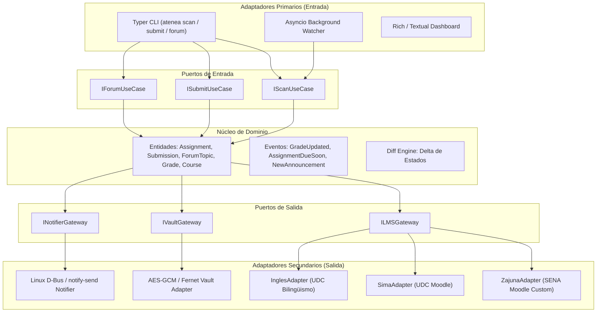
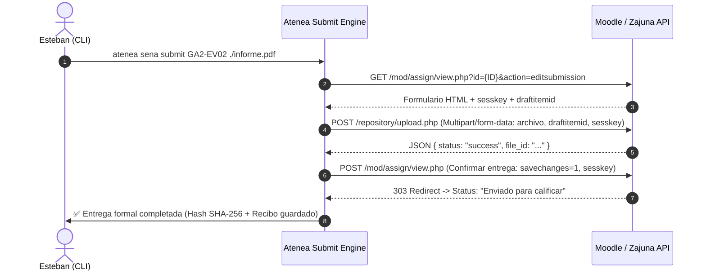

# 🏛️ Atenea V2 — Especificación de Arquitectura y Plan Maestro

**Sistema Unificado de Control Académico Bidireccional, Monitoreo en Vivo y Gestión de Entregas**  
*SENA (Zajuna LMS - Ficha ADSO 3545922) + Universidad de Cartagena (SIMA e Inglés Institucional)*

---

## 1. Visión y Objetivos de Ingeniería

Atenea V2 evoluciona de ser un visor pasivo basado en scripts y crons estáticos a un **Plano de Control Académico Bidireccional (CLI + Daemon Reactivo)** con estándares de ingeniería de software senior:

1. **Monitoreo en Tiempo Real (Live Scanning):** Inspección viva a demanda contra los servidores de Zajuna y Moodle, eliminando reportes cacheados desactualizados.
2. **Capacidad Bidireccional (Write Engine):** Capacidad de enviar evidencias formalmente (`submit`), responder foros de discusión y procesar cuestionarios/H5P directo desde la terminal.
3. **Resiliencia y Sesión Continua:** Renovación automática de sesiones (re-autenticación transparente con backoff exponencial), evitando caídas por cookies expiradas (como el error `HTTP 303 See Other`).
4. **Arquitectura Hexagonal (Puertos y Adaptadores):** Núcleo de dominio desacoplado de los protocolos de red y de las variaciones particulares de cada plataforma LMS.
5. **Experiencia Reactiva:** Daemon de fondo que dispara notificaciones locales (`notify-send` / D-Bus / Zellij status bar) ante eventos de cambio de notas, nuevos anuncios o deadlines inminentes.

---

## 2. Diagrama de Arquitectura Hexagonal



---

## 3. Modelo de Dominio y Entidades Clave

### 3.1. Entidades Principales
- **`Course`:** Identificador institucional, nombre, código, créditos, URL base.
- **`Assignment` (Evidencia / Tarea):** 
  - ID único, curso asociado, título, descripción técnica.
  - Fecha de apertura, fecha límite estricta.
  - Estado (`PENDING_SUBMISSION`, `SUBMITTED_WAITING_GRADE`, `APPROVED`, `REJECTED`).
  - Calificación (`A` / `D` para SENA; numérico `0.0 - 5.0` para UDC).
- **`Submission` (Entrega Formal):**
  - Hash criptográfico del archivo, timestamp local y remoto, ID de borrador de Moodle (`draftitemid`), URL de confirmación.
- **`ForumTopic` y `ForumPost`:**
  - ID de discusión, autor, fecha, contenido markdown, hilo de respuestas.

### 3.2. Diff Engine & Eventos de Dominio
El comparador de estados procesa el snapshot previo contra el escaneo en vivo:
- `GradePublishedEvent`: Se califica una evidencia enviada.
- `DeadlineApproachingEvent`: Falta < N horas para el cierre.
- `SubmissionConfirmedEvent`: Entrega subida y verificada formalmente con éxito.
- `AnnouncementPostedEvent`: Anuncio nuevo de instructor (ej. Haminton Páez).

---

## 4. Reverse-Engineering de la Subida de Tareas en Moodle/Zajuna (Write Engine)

La subida formal de evidencias desde CLI implementa el flujo de tres fases nativo de Moodle:



---

## 5. Estructura de Directorios del Proyecto (`atenea-v2`)

```
atenea/
├── pyproject.toml              # Definición de paquete con soporte uv
├── README.md
├── atenea/
│   ├── __init__.py
│   ├── __main__.py
│   ├── domain/                 # Núcleo 100% puro (sin dependencias externas)
│   │   ├── __init__.py
│   │   ├── entities.py         # Assignment, Course, Grade, Submission
│   │   ├── events.py           # Eventos del sistema
│   │   └── diff.py             # Comparador de deltas en memoria
│   ├── ports/                  # Interfaces abstractas
│   │   ├── __init__.py
│   │   ├── lms.py              # ILMSGateway
│   │   ├── vault.py            # IVaultGateway
│   │   └── notifier.py         # INotifierGateway
│   ├── adapters/               # Implementaciones de infraestructura
│   │   ├── __init__.py
│   │   ├── lms/
│   │   │   ├── base_moodle.py  # Cliente HTTP asíncrono base (httpx)
│   │   │   ├── sena_zajuna.py  # Adaptador específico SENA (TI/CC + Sofía)
│   │   │   ├── sima_udc.py     # Adaptador Moodle SIMA
│   │   │   └── ingles_udc.py   # Adaptador Moodle Inglés + extractor H5P
│   │   ├── vault/
│   │   │   └── aes_vault.py    # Bóveda cifrada local (AES-GCM / 0600)
│   │   └── notifiers/
│   │       └── linux_notify.py # Desktop notifications (notify-send / D-Bus)
│   ├── services/               # Casos de uso de aplicación
│   │   ├── __init__.py
│   │   ├── scan_service.py     # Orquestador de escaneo concurrente
│   │   ├── submit_service.py   # Orquestador del flujo de entregas
│   │   └── forum_service.py    # Orquestador de lectura y respuesta de foros
│   ├── cli/                    # Interfaz de Línea de Comandos
│   │   ├── __init__.py
│   │   ├── main.py             # Typer app principal
│   │   ├── commands/
│   │   │   ├── scan.py         # atenea scan [--live]
│   │   │   ├── submit.py       # atenea submit <id> <file>
│   │   │   ├── forum.py        # atenea forum [list|reply]
│   │   │   └── auth.py         # atenea auth [sena|sima|ingles]
│   │   └── formatters/         # Componentes Rich (tablas, páneles, deltas)
│   └── daemon/                 # Demonio reactivo de fondo
│       ├── __init__.py
│       └── watcher.py          # Bucle asíncrono con polling inteligente
└── tests/
    ├── unit/
    └── integration/
```

---

## 6. Comandos CLI Proyectados

```bash
# === ESCANEO EN TIEMPO REAL ===
atenea scan --live               # Escaneo en vivo de ambas instituciones
atenea scan --sena               # Escaneo exclusivo de SENA Zajuna
atenea scan --sima               # Escaneo exclusivo de UDC SIMA
atenea status                    # Resumen rápido consolidado

# === SUBIDA DE TAREAS Y EVIDENCIAS ===
atenea submit sena GA2-220501093-AA3-EV01 ./mapa_conceptual.pdf
atenea submit sima 62368 ./algoritmos_taller_u2.py

# === FOROS DE DISCUSIÓN ===
atenea forum sena list           # Listar foros activos
atenea forum sena read 8013611   # Leer discusiones y respuestas del foro
atenea forum sena reply 8013611 --file ./mi_aporte.md

# === BÓVEDA Y SEGURIDAD ===
atenea auth status               # Estado de las credenciales
atenea auth setup <plataforma>   # Configurar y verificar credenciales
```

---

## 7. Fases de Implementación

1. **Fase 1: Infraestructura y Dominio (Scaffolding)**
   - Configuración de `uv`, `pyproject.toml`, tipado estricto con `pydantic`.
   - Implementación de entidades de dominio y la bóveda criptográfica AES-GCM.
2. **Fase 2: Motor HTTP y Adaptadores de Lectura Concurrente**
   - Implementación de `BaseMoodleClient` con `httpx.AsyncClient`.
   - Refactor de `sena_zajuna.py` y `sima_udc.py` consumiendo endpoints JSON nativos.
   - Reparación definitiva del conector de inglés (eliminando bucles 303).
3. **Fase 3: Motor de Escritura (Subida de Evidencias y Foros)**
   - Implementación de la coreografía de 3 pasos para `atenea submit`.
   - Manejo de respuestas y publicación en foros con validación de hash de entrega.
4. **Fase 4: Daemon Reactivo y Notificaciones**
   - Servicio en segundo plano con polling adaptativo (menos peticiones si no hay actividad, más frecuente antes de deadlines).
   - Notificaciones nativas al entorno Linux.
