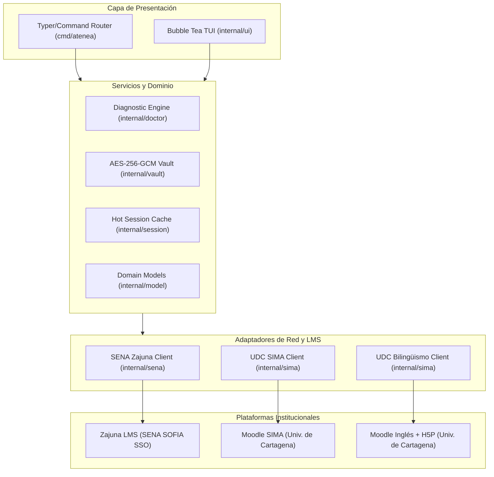

# 🏛️ Atenea

<p align="center">
  <strong>Suite de Inteligencia y Gestión Académica Unificada</strong><br>
  <em>SENA (Zajuna LMS - Ficha ADSO 3545922) + Universidad de Cartagena (SIMA e Inglés Institucional)</em>
</p>

<p align="center">
  
  
  
  
  
</p>

---

## ⚡ Visión y Filosofía

**Atenea** es un plano de control académico de ingeniería diseñado para eliminar la fricción, lentitud y fragilidad de los sistemas educativos institucionales (Zajuna LMS de SENA y Moodle SIMA de la Universidad de Cartagena).

Construida 100% en **Go nativo**, Atenea combina una interfaz TUI interactiva a 60 FPS con un CLI quirúrgico y automatizaciones seguras:

1. **Cero Dependencias en Runtime:** Un único binario estático compilado sin dependencias de Python, Node.js ni navegadores pesados en segundo plano.
2. **Local-First & Privacy First:** Bóveda de credenciales local cifrada con **AES-256-GCM** con permisos estrictos `0600`. Cero telemetría externa.
3. **Hot Session Cache:** Almacén de sesiones con persistencia atómica en `~/.cache/atenea/sessions.json` para reutilizar cookies activas, reduciendo latencia y evitando bloqueos de WAF (anti-tarpit).
4. **Resiliencia y Precisión Académica:**
   - Separación estricta de notas del SENA: distingue evidencias Aprobadas (`A`) de Deficientes (`D` - no aprobadas).
   - Extracción de códigos de evidencia normalizados (`GA\d+-[A-Z0-9-]+-EV\d+`).
   - Herramienta de salud diagnóstica integrada (`atenea doctor`) con sondas de latencia y verificación de endpoints AJAX.

---

## 🏗️ Arquitectura del Sistema



---

## 🚀 Instalación y Compilación

### Requisitos
- Linux (x86_64 / arm64)
- Go 1.22+ instalado

### Compilación rápida

```bash
# Clonar el repositorio
git clone https://github.com/e12jassir/atenea.git
cd atenea

# Compilar binario optimizado
make build

# Instalar en ~/.local/bin/atenea
make install
```

Asegúrate de tener `~/.local/bin` en tu variable de entorno `$PATH`:
```bash
export PATH="$HOME/.local/bin:$PATH"
```

---

## 🎮 Guía de Comandos CLI

### 🩺 Diagnóstico del Sistema y Credenciales

```bash
# Diagnóstico completo de conectividad, WAF, sesiones y bóveda
atenea doctor

# Configurar o verificar credenciales en la bóveda cifrada
atenea auth
atenea auth sena
atenea auth sima
atenea auth ingles
```

### 👷 SENA ADSO (Ficha 3545922)

```bash
# Estado general de evidencias y anuncios del instructor
atenea sena status

# Lista prioritaria de evidencias pendientes y deficientes (D)
atenea sena pending

# Reporte consolidado de calificaciones y resultados de aprendizaje
atenea sena report
atenea sena grades
```

### 🎓 Universidad de Cartagena (SIMA)

```bash
# Estado de materias, anuncios y eventos próximos en SIMA
atenea sima status

# Cuadro de calificaciones acumuladas del semestre
atenea sima grades

# Lista detallada de anuncios de los docentes
atenea sima announcements
```

### 🗣️ UDC Bilingüismo (Inglés)

```bash
# Estado general del curso de inglés
atenea ingles status

# Desglose de calificaciones por unidad (64 evidencias)
atenea ingles breakdown
```

### 🖥️ Interfaz Visual Interactiva (TUI)

```bash
# Iniciar el dashboard interactivo de terminal (Bubble Tea + Lip Gloss)
atenea
```

---

## 🔐 Seguridad y Bóveda Criptográfica

Atenea almacena las credenciales de acceso de forma estrictamente local mediante una arquitectura **fail-closed**:

- **Algoritmo:** Cifrado autenticado **AES-256-GCM** (Galois/Counter Mode).
- **Almacén:** Archivo cifrado `~/.config/atenea/vault_go.enc` protegido con permisos POSIX `0600` (solo lectura/escritura para el usuario actual).
- **Clave Criptográfica:** Generada con entropía criptográfica (`crypto/rand`) de 32 bytes en `~/.config/atenea/.vault_go.key` (modo `0600`). Si la clave se corrompe, el sistema aborta de inmediato protegiendo los datos existentes contra sobreescritura vacía.
- **Escrituras Atómicas:** Toda persistencia en disco escribe primero en un archivo temporal (`.tmp`), ejecuta `f.Sync()` para vaciar los buffers del kernel al disco físico, y luego realiza un `os.Rename()` atómico para prevenir pérdidas de datos ante cortes imprevistos de energía.

---

## 📁 Estructura del Código

```
atenea/
├── cmd/
│   └── atenea/
│       └── main.go              # CLI Router y despacho de comandos
├── internal/
│   ├── doctor/                  # atenea doctor (sondas de red, WAF, estado)
│   ├── model/                   # Entidades de dominio unificadas
│   ├── sena/                    # Cliente Zajuna LMS (SENA ADSO)
│   ├── session/                 # Hot Session Cache con persistencia atómica
│   ├── sima/                    # Cliente Moodle SIMA y Bilingüismo UDC
│   ├── ui/                      # Dashboard interactivo Bubble Tea
│   └── vault/                   # Bóveda cifrada AES-256-GCM
├── Makefile                     # Automatización de build e instalación
├── PLAN_ARQUITECTURA_V2.md      # Hoja de ruta técnica para Atenea V2
├── go.mod
└── go.sum
```

---

## 🧪 Pruebas Unitarias

El proyecto cuenta con suites de pruebas unitarias completas con aislamiento de red mediante `httptest.Server` y directorios temporales `t.TempDir()`:

```bash
# Ejecutar todas las pruebas unitarias
go test -v ./...

# Ejecutar con detector de condiciones de carrera (Race Detector)
go test -race ./...
```

---

## 📄 Licencia

Este proyecto está bajo la Licencia [MIT](LICENSE). Desarrollado por **Esteban Marrugo** ([@e12jassir](https://github.com/e12jassir)).
